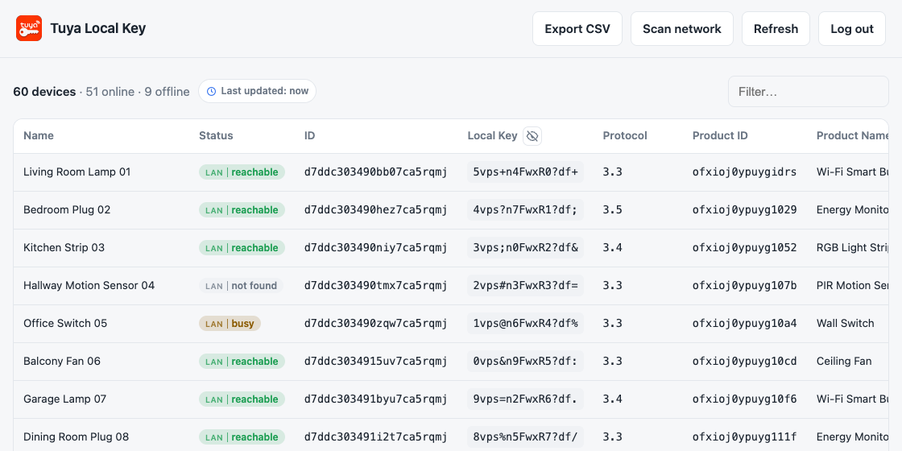

[](https://github.com/sponsors/vineetchoudhary)
[](https://buymeacoffee.com/vineetchoudhary)
[](https://github.com/vineetchoudhary/tuya-local-key/actions/workflows/docker-publish.yml)
[](https://github.com/vineetchoudhary/tuya-local-key/pkgs/container/tuya-local-key)

# Tuya Local Key

Retrieve local keys for your Smart Life / Tuya devices with QR-code login. No Tuya IoT developer account or cloud project is needed. Use the web UI with Docker or Home Assistant, or run the CLI locally.

<picture>
  <source media="(prefers-color-scheme: dark)" srcset="docs/screenshots/header-devices-dark.png">
  <source media="(prefers-color-scheme: light)" srcset="docs/screenshots/header-devices-light.png">
  
</picture>

## Features

- View and copy local keys, device details, Node IDs, and data points.
- Find local IP addresses and protocol versions, including across VLANs.
- Detect changed keys, IP addresses, protocol versions, and devices.
- Filter by home, search or exclude devices, export CSV, and keep an encrypted cache across restarts.
- Get setup values for tuya-local, localtuya, and tinytuya.

## Quick Start

### Home Assistant

On Home Assistant OS, add this repository, then install and start **Tuya Local Key** from the app store. Open it from the sidebar and [log in](docs/usage.md#web-login-flow).

[](https://my.home-assistant.io/redirect/supervisor_add_addon_repository/?repository_url=https%3A%2F%2Fgithub.com%2Fvineetchoudhary%2Ftuya-local-key)

### Docker Compose

Run from this repository using [docker-compose.yml](docker-compose.yml):

```bash
docker compose up -d
```

Open [http://localhost:8000](http://localhost:8000) and [log in](docs/usage.md#web-login-flow).

### Docker

Run the published Docker image:

```bash
docker run -d --name tuya-local-key -p 8000:8000 -v tuya-session:/data ghcr.io/vineetchoudhary/tuya-local-key:latest
```

Open [http://localhost:8000](http://localhost:8000), enter your [Smart Life user code](docs/usage.md#finding-your-user-code), then scan and confirm the QR code in the app.

The web UI has no authentication by default. For access beyond localhost, set both `AUTH_USERNAME` and `AUTH_PASSWORD` and read the [security guidance](docs/configuration.md#security).

### CLI

Run from this repository:

```bash
./setup.sh
.venv/bin/python tuya_devices.py
```

Follow the QR login prompts. See the [CLI guide](docs/cli.md) for options.

## Documentation

- [Installation](docs/installation.md) — Home Assistant, Docker, Docker Compose, and source setup.
- [Using the app](docs/usage.md) — QR login, device details, local integrations, and Bluetooth devices.
- [Network scanning](docs/network-scanning.md) — Local IPs, protocol versions, VLANs, gateways, and scan statuses.
- [Caching and changes](docs/caching-and-changes.md) — Saved devices, offline snapshots, and change detection.
- [Configuration](docs/configuration.md) — Environment variables and security.
- [CLI](docs/cli.md) — Terminal setup, commands, and flags.
- [Troubleshooting](docs/troubleshooting.md) — Common login, key, and connection issues.
- [Screenshots](docs/screenshots.md) — Light and dark previews.
- [Frontend structure](docs/frontend-structure.md): Templates, stylesheets, JavaScript modules, and development checks.

## License

Tuya Local Key is licensed under the [Apache License, Version 2.0](LICENSE). See [NOTICE](NOTICE) for attribution information.

## Support

If this project has been useful to you, consider supporting its continued development.

<a href="https://github.com/sponsors/vineetchoudhary">
  
</a>

<a href="https://buymeacoffee.com/vineetchoudhary">
  
</a>

Thank you for supporting open source! 🙏
