# Screenshots

These previews use a demo account. Each image switches between light and dark to match your theme.

## Login

<picture>
  <source media="(prefers-color-scheme: dark)" srcset="screenshots/login-dark.png">
  <source media="(prefers-color-scheme: light)" srcset="screenshots/login-light.png">
  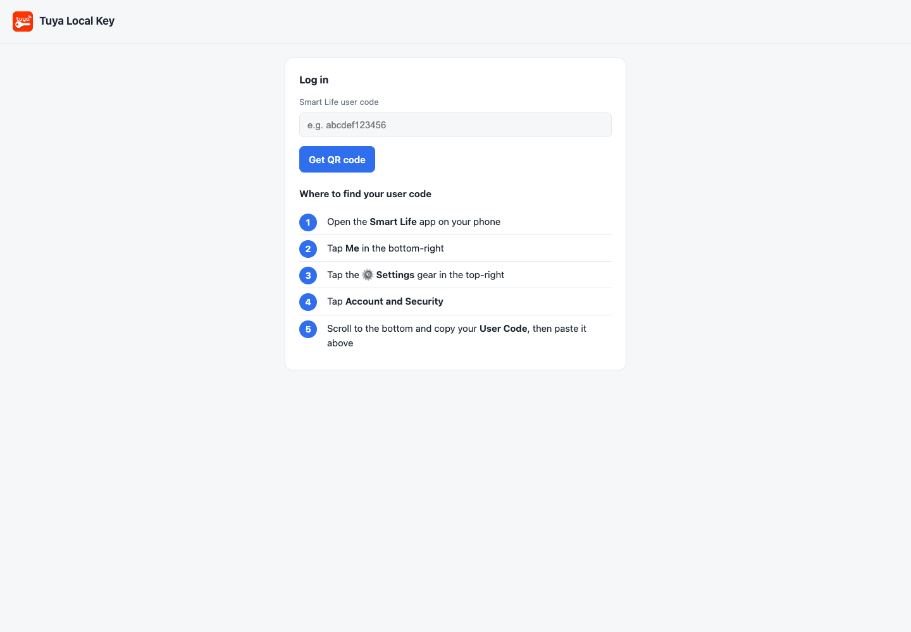
</picture>

## QR Login

<picture>
  <source media="(prefers-color-scheme: dark)" srcset="screenshots/qr-login-dark.png">
  <source media="(prefers-color-scheme: light)" srcset="screenshots/qr-login-light.png">
  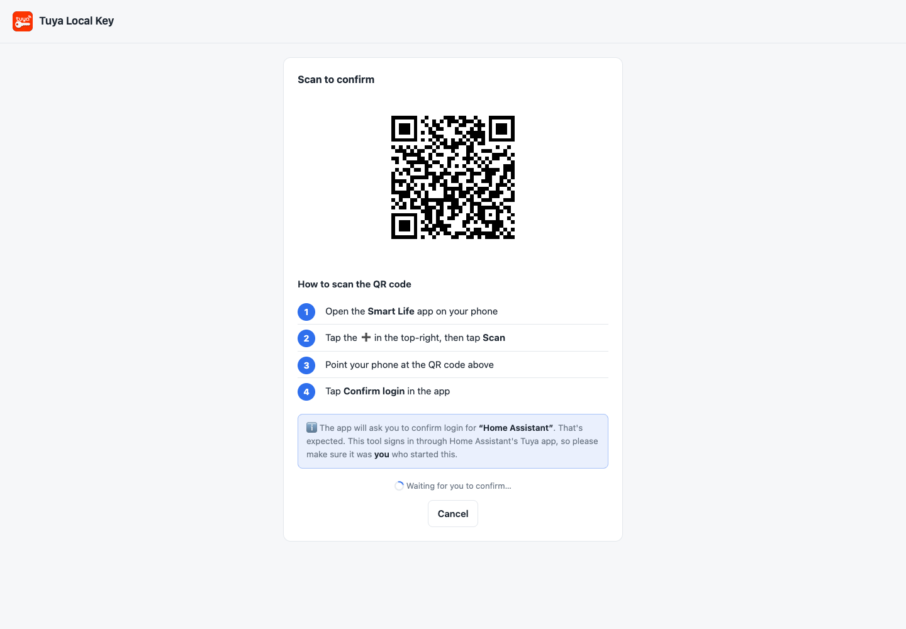
</picture>

## Device Table

<picture>
  <source media="(prefers-color-scheme: dark)" srcset="screenshots/devices-dark.png">
  <source media="(prefers-color-scheme: light)" srcset="screenshots/devices-light.png">
  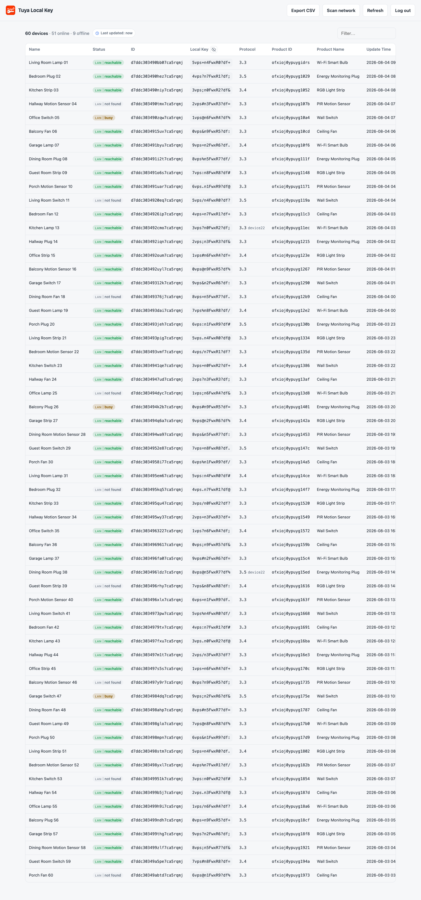
</picture>

## Change Summary

<picture>
  <source media="(prefers-color-scheme: dark)" srcset="screenshots/changes-dark.png">
  <source media="(prefers-color-scheme: light)" srcset="screenshots/changes-light.png">
  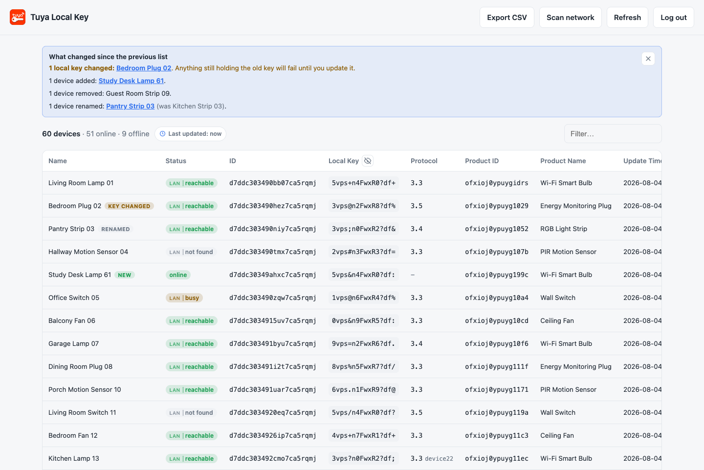
</picture>

## Network Scan

<picture>
  <source media="(prefers-color-scheme: dark)" srcset="screenshots/scan-dark.png">
  <source media="(prefers-color-scheme: light)" srcset="screenshots/scan-light.png">
  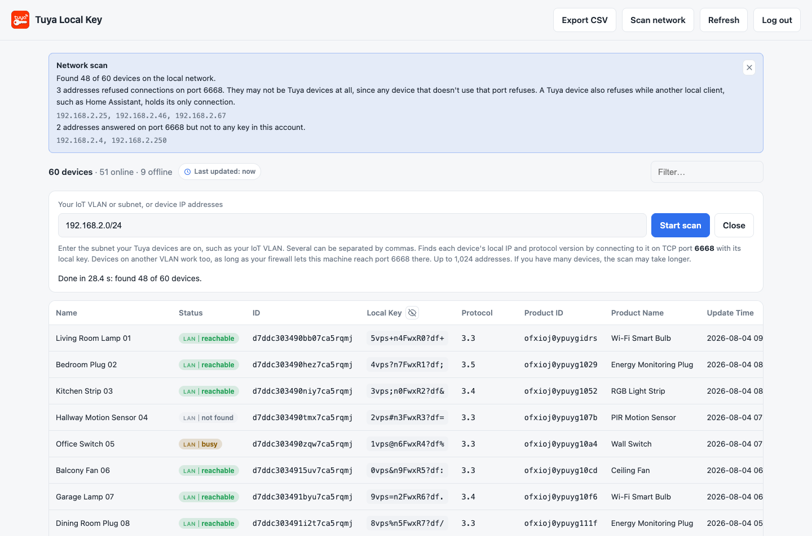
</picture>

## Device Details

<picture>
  <source media="(prefers-color-scheme: dark)" srcset="screenshots/details-dark.png">
  <source media="(prefers-color-scheme: light)" srcset="screenshots/details-light.png">
  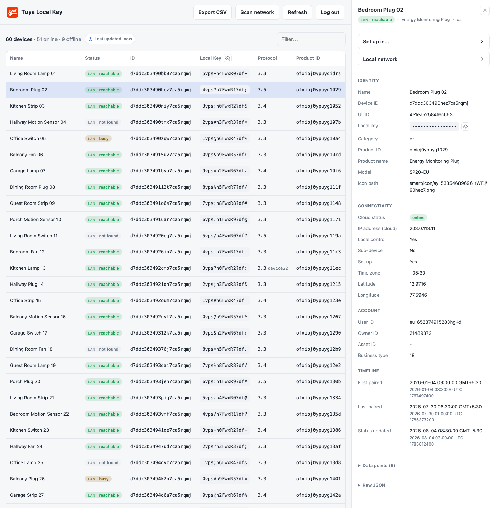
</picture>

## Set up in…

Choose a tool to see the values needed for local setup, with copy buttons for each field. See the [setup guide](usage.md#set-up-a-local-integration).

### tuya-local

<picture>
  <source media="(prefers-color-scheme: dark)" srcset="screenshots/setup-tuya-local-dark.png">
  <source media="(prefers-color-scheme: light)" srcset="screenshots/setup-tuya-local-light.png">
  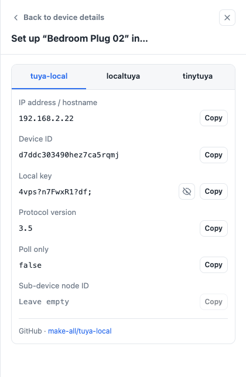
</picture>

### localtuya

<picture>
  <source media="(prefers-color-scheme: dark)" srcset="screenshots/setup-localtuya-dark.png">
  <source media="(prefers-color-scheme: light)" srcset="screenshots/setup-localtuya-light.png">
  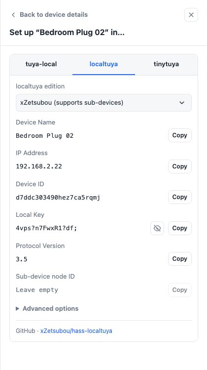
</picture>

### tinytuya

<picture>
  <source media="(prefers-color-scheme: dark)" srcset="screenshots/setup-tinytuya-dark.png">
  <source media="(prefers-color-scheme: light)" srcset="screenshots/setup-tinytuya-light.png">
  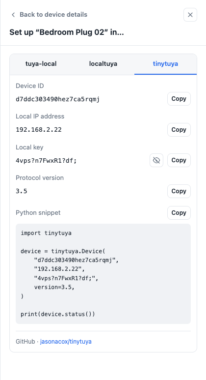
</picture>

## Local Network

Review the last connection result, check a local IP address or scan the network again. See [network scanning](network-scanning.md).

<picture>
  <source media="(prefers-color-scheme: dark)" srcset="screenshots/local-network-dark.png">
  <source media="(prefers-color-scheme: light)" srcset="screenshots/local-network-light.png">
  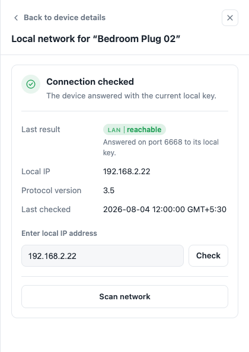
</picture>

## Filtering

<picture>
  <source media="(prefers-color-scheme: dark)" srcset="screenshots/filter-dark.png">
  <source media="(prefers-color-scheme: light)" srcset="screenshots/filter-light.png">
  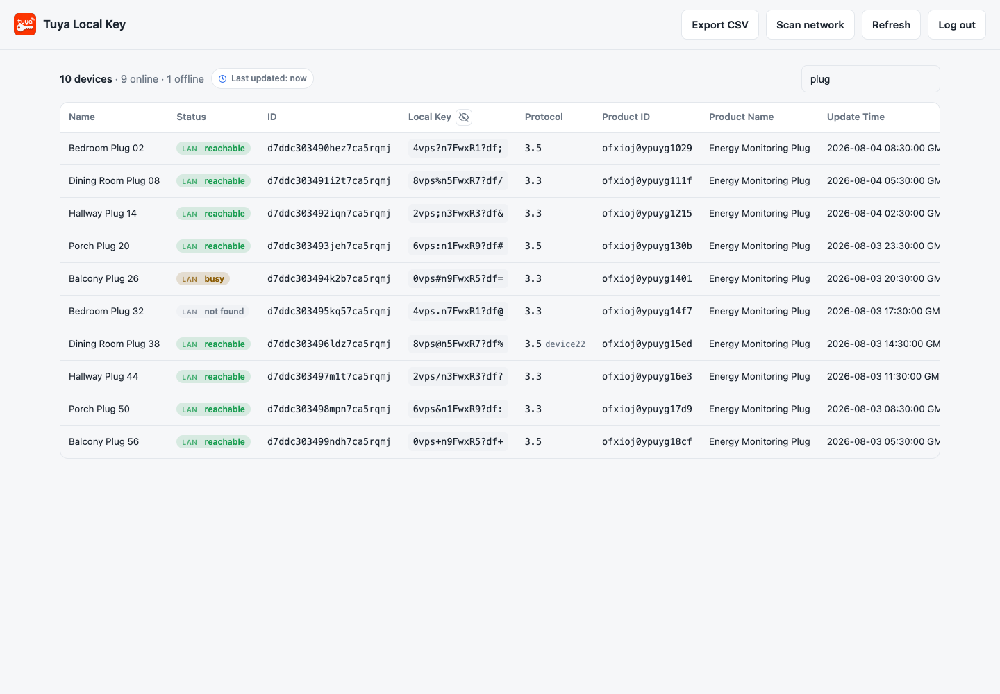
</picture>
