# Screenshots

These previews use a demo account. Each image switches between light and dark to match your theme.

## Login

<picture>
  <source media="(prefers-color-scheme: dark)" srcset="screenshots/login-dark.png">
  <source media="(prefers-color-scheme: light)" srcset="screenshots/login-light.png">
  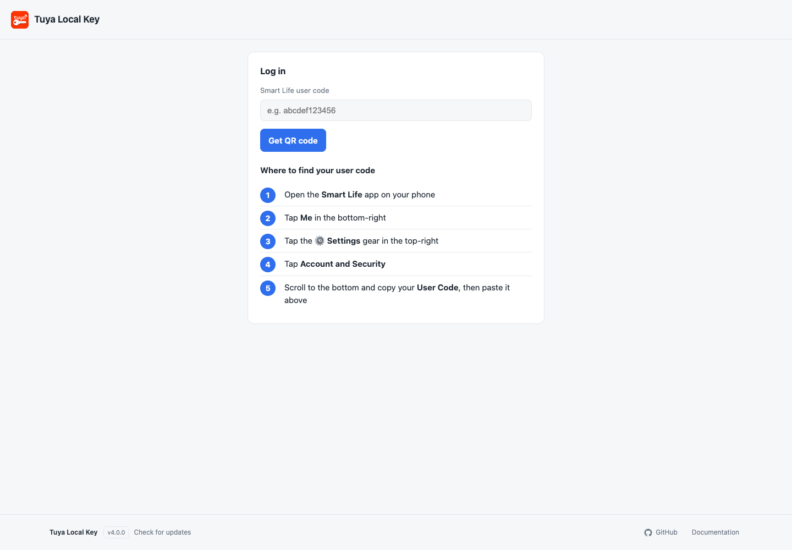
</picture>

## QR Login

<picture>
  <source media="(prefers-color-scheme: dark)" srcset="screenshots/qr-login-dark.png">
  <source media="(prefers-color-scheme: light)" srcset="screenshots/qr-login-light.png">
  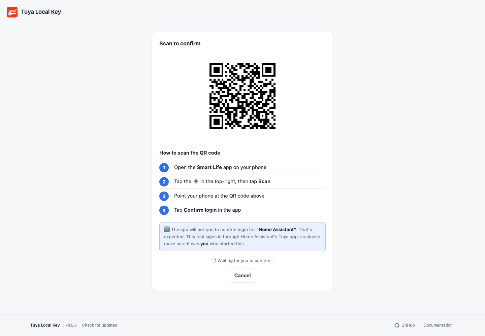
</picture>

## Device Table

<picture>
  <source media="(prefers-color-scheme: dark)" srcset="screenshots/devices-dark.png">
  <source media="(prefers-color-scheme: light)" srcset="screenshots/devices-light.png">
  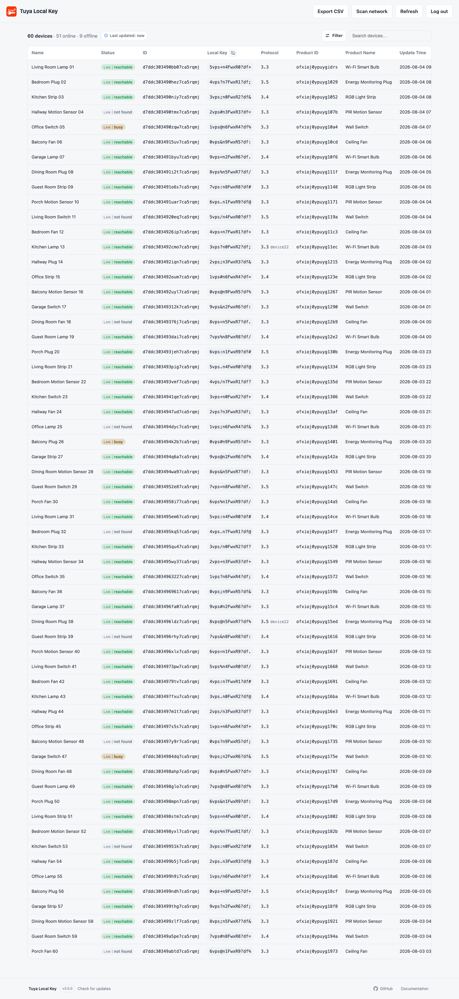
</picture>

## Update Badge

This preview shows a simulated update.

<picture>
  <source media="(prefers-color-scheme: dark)" srcset="screenshots/header-update-dark.png">
  <source media="(prefers-color-scheme: light)" srcset="screenshots/header-update-light.png">
  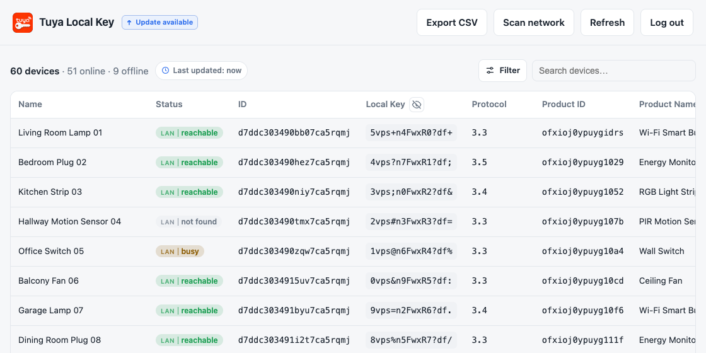
</picture>

### Update Available

<picture>
  <source media="(prefers-color-scheme: dark)" srcset="screenshots/update-available-dark.png">
  <source media="(prefers-color-scheme: light)" srcset="screenshots/update-available-light.png">
  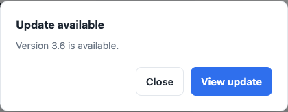
</picture>

### No Updates Available

<picture>
  <source media="(prefers-color-scheme: dark)" srcset="screenshots/no-updates-dark.png">
  <source media="(prefers-color-scheme: light)" srcset="screenshots/no-updates-light.png">
  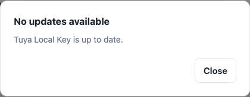
</picture>

## Change Summary

<picture>
  <source media="(prefers-color-scheme: dark)" srcset="screenshots/changes-dark.png">
  <source media="(prefers-color-scheme: light)" srcset="screenshots/changes-light.png">
  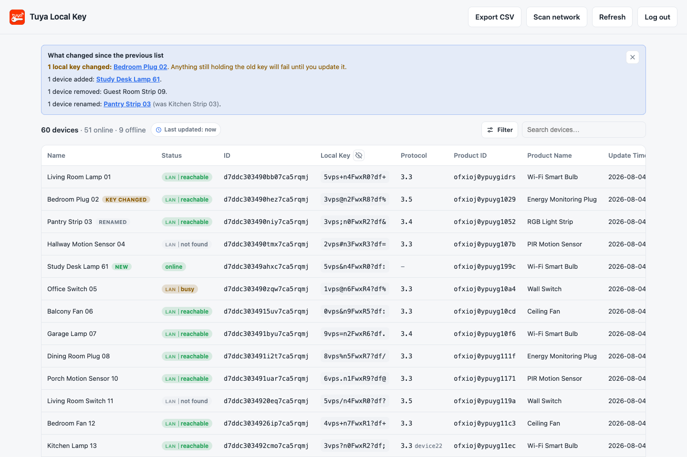
</picture>

## Network Scan

<picture>
  <source media="(prefers-color-scheme: dark)" srcset="screenshots/scan-dark.png">
  <source media="(prefers-color-scheme: light)" srcset="screenshots/scan-light.png">
  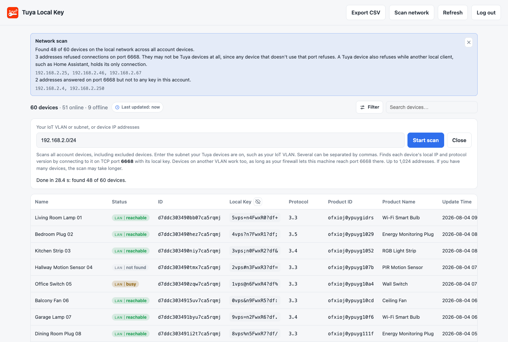
</picture>

## Device Options

<picture>
  <source media="(prefers-color-scheme: dark)" srcset="screenshots/details-dark.png">
  <source media="(prefers-color-scheme: light)" srcset="screenshots/details-light.png">
  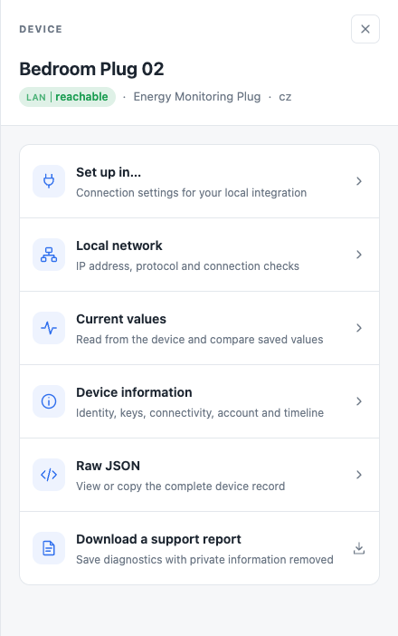
</picture>

## Device Information

<picture>
  <source media="(prefers-color-scheme: dark)" srcset="screenshots/device-information-dark.png">
  <source media="(prefers-color-scheme: light)" srcset="screenshots/device-information-light.png">
  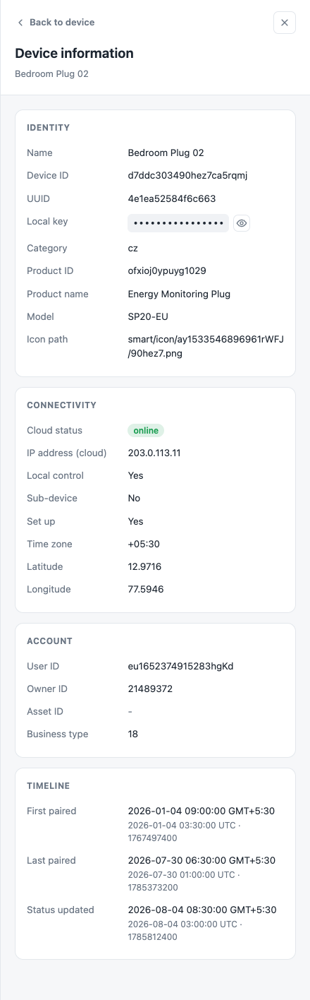
</picture>

## Raw JSON

<picture>
  <source media="(prefers-color-scheme: dark)" srcset="screenshots/raw-json-dark.png">
  <source media="(prefers-color-scheme: light)" srcset="screenshots/raw-json-light.png">
  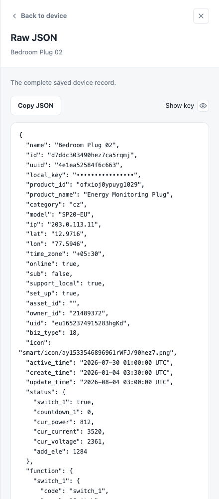
</picture>

## Set up in…

See the [setup guide](usage.md#set-up-a-local-integration).

### tuya-local

<picture>
  <source media="(prefers-color-scheme: dark)" srcset="screenshots/setup-tuya-local-dark.png">
  <source media="(prefers-color-scheme: light)" srcset="screenshots/setup-tuya-local-light.png">
  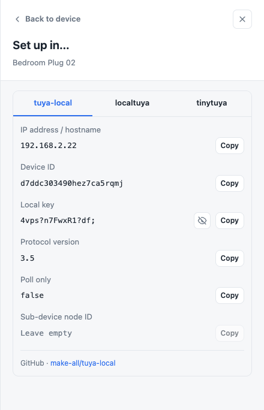
</picture>

### localtuya

<picture>
  <source media="(prefers-color-scheme: dark)" srcset="screenshots/setup-localtuya-dark.png">
  <source media="(prefers-color-scheme: light)" srcset="screenshots/setup-localtuya-light.png">
  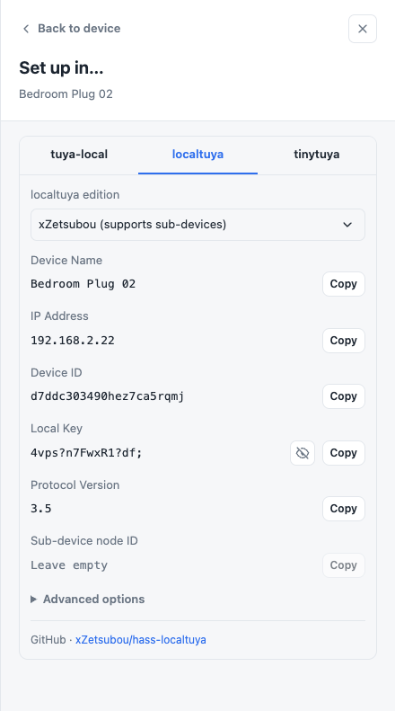
</picture>

### tinytuya

<picture>
  <source media="(prefers-color-scheme: dark)" srcset="screenshots/setup-tinytuya-dark.png">
  <source media="(prefers-color-scheme: light)" srcset="screenshots/setup-tinytuya-light.png">
  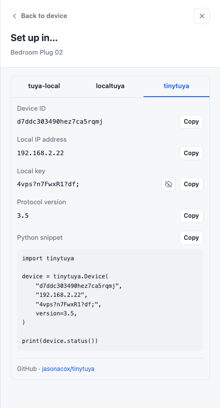
</picture>

## Local Network

Review the last connection result, check a local IP address or scan the network again. See [network scanning](network-scanning.md).

<picture>
  <source media="(prefers-color-scheme: dark)" srcset="screenshots/local-network-dark.png">
  <source media="(prefers-color-scheme: light)" srcset="screenshots/local-network-light.png">
  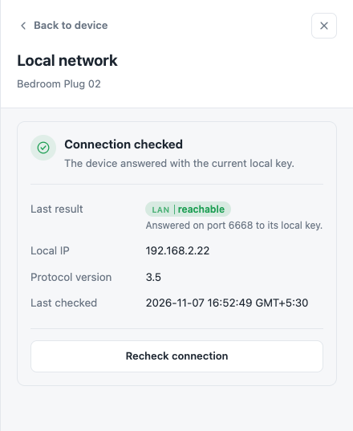
</picture>

## Fix Connection

The wizard guides you through device details, a connection test and next steps. See [Fix connection](network-scanning.md#fix-connection).

### Details

<picture>
  <source media="(prefers-color-scheme: dark)" srcset="screenshots/fix-connection-details-dark.png">
  <source media="(prefers-color-scheme: light)" srcset="screenshots/fix-connection-details-light.png">
  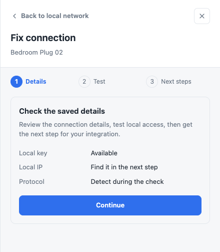
</picture>

### Test

<picture>
  <source media="(prefers-color-scheme: dark)" srcset="screenshots/fix-connection-test-dark.png">
  <source media="(prefers-color-scheme: light)" srcset="screenshots/fix-connection-test-light.png">
  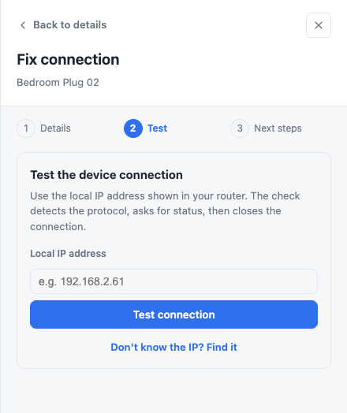
</picture>

### Next steps

<picture>
  <source media="(prefers-color-scheme: dark)" srcset="screenshots/fix-connection-result-dark.png">
  <source media="(prefers-color-scheme: light)" srcset="screenshots/fix-connection-result-light.png">
  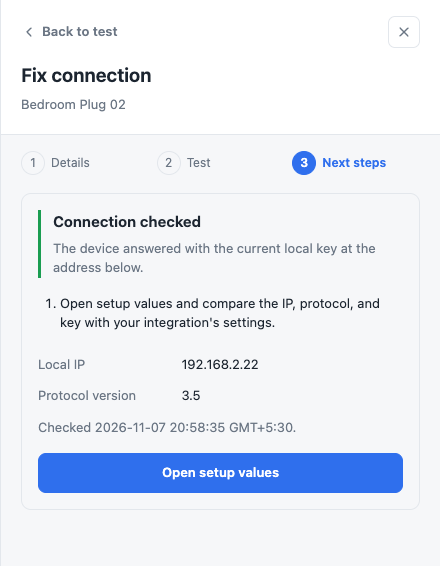
</picture>

## Current Values

Saved cloud values and a manual local reading appear side by side, with data point definitions below. See [Current values](usage.md#read-current-values).

<picture>
  <source media="(prefers-color-scheme: dark)" srcset="screenshots/current-values-dark.png">
  <source media="(prefers-color-scheme: light)" srcset="screenshots/current-values-light.png">
  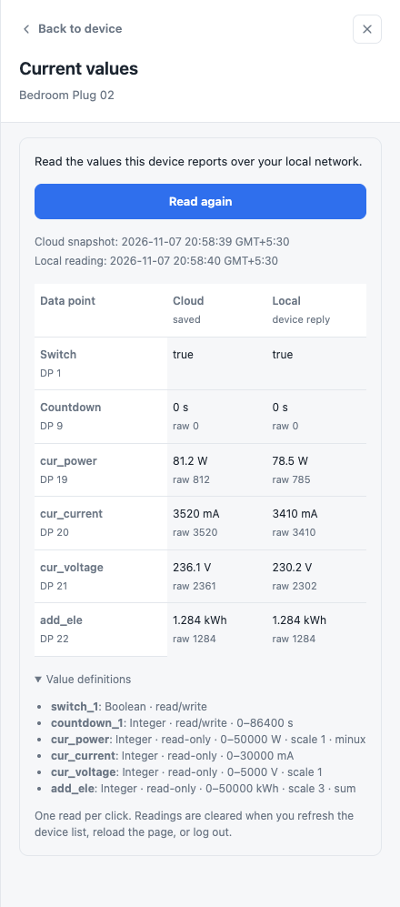
</picture>

## Support Report

Choose **Download a support report** from the device menu, then [attach the file to a bug report](usage.md#download-a-support-report).

<picture>
  <source media="(prefers-color-scheme: dark)" srcset="screenshots/support-report-dark.png">
  <source media="(prefers-color-scheme: light)" srcset="screenshots/support-report-light.png">
  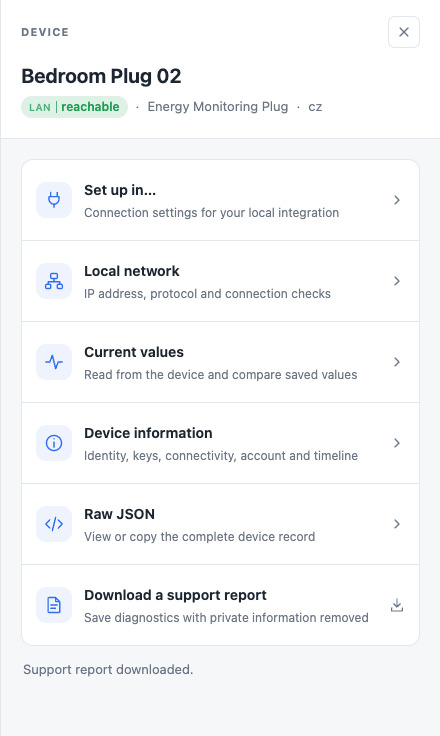
</picture>

## Filtering

<picture>
  <source media="(prefers-color-scheme: dark)" srcset="screenshots/filter-dark.png">
  <source media="(prefers-color-scheme: light)" srcset="screenshots/filter-light.png">
  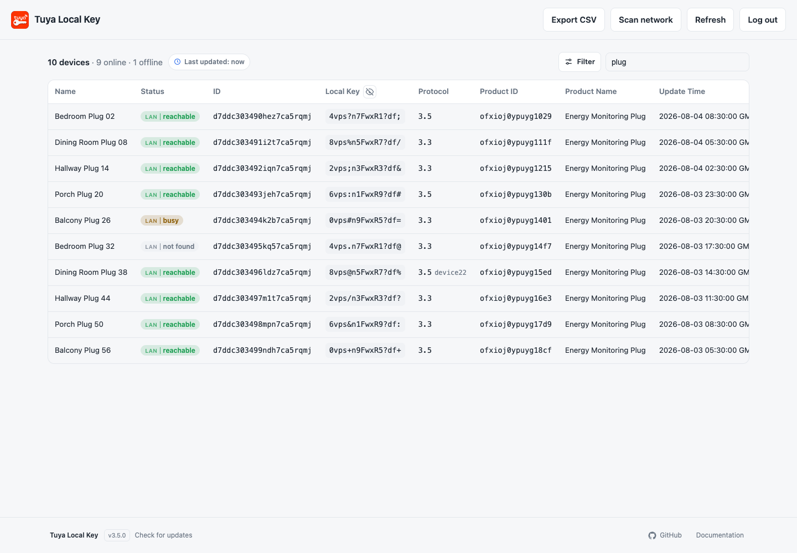
</picture>
